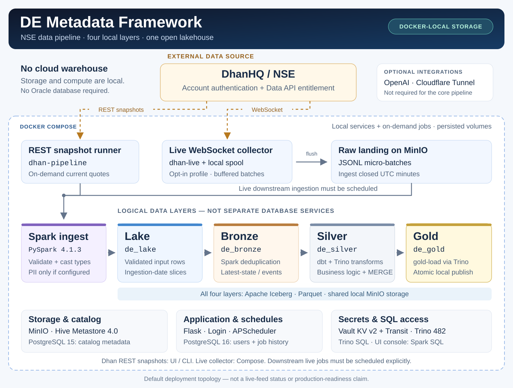

# DE Metadata Framework

A Docker-based NSE data platform with four local Apache Iceberg layers on
MinIO. Trino provides SQL access to Lake, Bronze, Silver, and Gold. Oracle is
not required.

Start with [the Windows/Docker guide](docs/START_HERE.md),
[Dhan configuration](docs/DHAN_NSE.md), and the
[compatibility report](docs/COMPATIBILITY.md).

Before publishing changes, follow [the credential-safety checks](SECURITY.md).
Real `.env` settings and runtime tokens must remain local.

## Architecture



[Open the full-size architecture diagram](docs/assets/architecture.svg).
The image is maintained in this repository and describes the default topology,
not whether a live Dhan connection is currently active. All four layers are
logical namespaces on shared local MinIO storage; none requires Oracle.

Dhan is the external market-data provider and requires your account credentials
and Data API entitlement. Storage, catalog, processing, application database,
UI, scheduler, and the default Gold destination run in Docker. OpenAI and
Cloudflare are optional and are not needed to process data.

CSV, JSON, and Parquet in S3-compatible storage and PostgreSQL sources are also
supported. The homepage opens on Dhan/NSE with local setup status, the current
India date, and Lake/Bronze/Silver/Gold navigation. An explicit **Fetch snapshot**
action runs Dhan REST ingestion into Lake and then Bronze. Quote, OHLC, and LTP
are supported. Enter NSE stock symbols such as `RELIANCE,HDFCBANK`; snapshot
execution resolves the numeric IDs against Dhan's public instrument master.
Use **Resolve symbols** first if you want to preview the mapping.
S3 and PostgreSQL remain available as alternative sources.
The live WebSocket collector is an opt-in Compose service.

## Start locally

Docker Desktop must run in Linux-container mode. Allow roughly 8 GB of Docker
memory and enough disk for images and build caches. Run from the repository
directory in PowerShell:

```powershell
powershell -NoProfile -ExecutionPolicy Bypass -File scripts/start-local.ps1
```

The script creates a missing `.env` from [`.env.example`](.env.example),
generates local passwords and secrets, builds images, starts services, and
waits for readiness checks. It preserves an existing `.env`; replace any
remaining `REQUIRED_...` placeholders there.

Open <http://localhost:5001>. Sign in as `root` using `ROOT_PASSWORD` from
your local `.env`. User administration is at <http://localhost:5001/users>.
`ui/templates/users.html` is rendered by Flask; opening the file directly
does not start the application.

The Dhan setup panel inspects local configuration only. Opening the page or
refreshing status never calls Dhan, mints a token, or starts a job. Locally
configured settings are explicitly shown as unverified; real authentication
and Data API entitlement are checked when you run a snapshot. Credentials
stay on the server, with browser-consent/token creation handled by the CLI.
See [the Dhan UI workflow](docs/DHAN_NSE.md#use-the-dhan-homepage).

To create configuration without starting services:

```powershell
powershell -NoProfile -ExecutionPolicy Bypass -File scripts/start-local.ps1 -PrepareOnly
```

Keep `.env` private. Dhan credentials can stay blank for synthetic-data
testing. Oracle, OpenAI, Cloudflare, and external PostgreSQL accounts are not
prerequisites for the local four-layer pipeline.

## Check compatibility

```powershell
powershell -NoProfile -ExecutionPolicy Bypass -File scripts/check-compatibility.ps1
```

This runs a separate `de-compat` project with its own volumes, container names,
and test accounts. The check covers real Spark/Iceberg writes, Bronze
deduplication, Trino interoperability, NSE dbt models, replay, empty input,
HTTP user administration, and unconfigured Dhan homepage/status behavior.
It does not authenticate against Dhan.

See [COMPATIBILITY.md](docs/COMPATIBILITY.md) for the passed four-layer and
local Gold checks, plus remaining external-account and production limitations.
Test data is retained for inspection.
Stop test services without deleting their data:

```powershell
docker compose -p de-compat --env-file .env.example -f docker-compose.yml -f tests/docker-compose.compat.yml stop
```

## Run NSE snapshots through every layer

Follow [DHAN_NSE.md](docs/DHAN_NSE.md) to configure your Dhan client ID, choose
browser-consent or PIN/TOTP authentication, select NSE stock symbols, and
validate your Data API subscription. Never paste credentials into source
files, command arguments, chat, or Git.

Maintain repository-root `symbols.csv` and set
`DHAN_SYMBOLS_FILE=/app/config/symbols.csv`, use inline
`DHAN_SYMBOLS=RELIANCE,HDFCBANK`, or enter symbols in the homepage for that run.
Configure exactly one saved source: CSV file, inline symbols, or
`DHAN_INSTRUMENTS` segment/security-ID pairs. The other two must be blank.
CSV changes are reread on resolve/fetch; refresh setup to reload the count.
Symbol
lookup is an explicit public-master download/cache operation, not account
authentication. Page load and status refresh still perform no network lookup.

You can fetch Lake/Bronze manually from the homepage after completing local
setup. The page accepts only today's Asia/Kolkata date; Silver and Gold remain
explicit downstream actions. The equivalent CLI flow below remains supported.
Use the same India date for the REST snapshot and downstream jobs:

```powershell
$runDate = [System.TimeZoneInfo]::ConvertTimeBySystemTimeZoneId([DateTime]::UtcNow, 'India Standard Time').ToString('yyyy-MM-dd')

docker compose run --rm dhan-pipeline --application-name nse_market_snapshot --source-type dhan --ingest-date $runDate --metadata-key examples/dhan_market_snapshot.csv

docker compose run --rm pipeline bronze --application-name nse_market_snapshot --run-date $runDate --run-type full --metadata-key examples/dhan_market_snapshot.csv

docker compose run --rm pipeline dbt-run --application-name nse_market_snapshot --run-date $runDate --dbt-select nse_market_snapshot

docker compose run --rm pipeline gold-load --application-name nse_market_snapshot --silver-table nse_market_snapshot --gold-table nse_market_snapshot --load-strategy replace --run-date $runDate
```

Tables are named `minio.de_lake.nse_market_snapshot`,
`minio.de_bronze.nse_market_snapshot`,
`minio.de_silver.nse_market_snapshot`, and
`minio.de_gold.nse_market_snapshot`. Query the local Gold table through Trino:

```sql
SELECT * FROM minio.de_gold.nse_market_snapshot;
```

The reference Trino catalog is `minio`. Changing `ICEBERG_CATALOG` requires
a matching Trino catalog configuration.

For live data, collect raw JSONL with `dhan-live`, ingest closed UTC minutes
as application `nse_live_ticks` with `examples/dhan_live_ticks.csv`, run
Bronze `full` for the chosen day, then select the `nse_live_ticks` dbt
model and publish it to Gold. The collector does not automatically launch
downstream jobs; schedule them explicitly. See the Dhan guide for commands.

## Layer behavior

| Layer | Processing | Default namespace |
|---|---|---|
| Lake | Validate columns, cast metadata types, apply configured PII rules, retain ingestion-date partitions | `de_lake` |
| Bronze | Deduplicate a selected date; optionally merge an earlier snapshot for latest-state workloads | `de_bronze` |
| Silver | Transform Bronze with dbt/Trino; bundled NSE models use MERGE for replay | `de_silver` |
| Gold | Publish curated Silver data as a local analytics table with an atomic Iceberg commit | `de_gold` |

Lake `append` retains incoming rows, including duplicates on replay.
Lake `overwrite` replaces the affected ingestion-date partitions. Empty input
is rejected.

Bronze `full` processes the requested Lake date and replaces that snapshot
partition. `delta` merges it with the latest earlier snapshot, keeping the
newest timestamp per primary key; incoming records win timestamp ties.
An empty Lake date is rejected without changing existing Bronze data.
Use `delta` for cumulative state rather than daily tick-event history.

Snapshot metadata keys instruments by exchange segment and security ID.
Live metadata keys events by stable `event_id`. Preserve original event IDs
when replaying landed objects.

Gold publishes the selected Silver data; business aggregations must be
defined in Silver before publication if your analytics require them.

### Local Gold strategies

| Strategy | Behavior |
|---|---|
| `replace` | Default: atomically replace the full Gold contents from Silver; replay is safe |
| `append` | Add source rows; replay duplicates them |
| `delete_and_insert` | Atomically replace the selected date scope |

`--run-date` is optional for `replace` and `append`. Date-scoped publication
requires `--date-column snapshot_date --run-date YYYY-MM-DD` with
`--load-strategy delete_and_insert`. Readers see the previous or new
committed Iceberg snapshot rather than partially published contents.

Defaults are `GOLD_DATABASE=de_gold` and `GOLD_DATA_BUCKET=de-data-gold`.
Gold reuses MinIO, the shared catalog, Trino, and the pipeline image.

## Docker services

| Service | Responsibility | Local access |
|---|---|---|
| `minio` | Object storage, built from pinned official source | API `localhost:9000`; console `localhost:9001` |
| `minio-init` | One-shot buckets and metadata-example provisioning | Internal |
| `vault` | KV/Transit secrets | `localhost:8200` |
| `vault-init` | Bootstrap, unseal, and pipeline-token management | Internal |
| `postgres-meta` | PostgreSQL 15 metastore backend | Internal |
| `postgres-app` | PostgreSQL 16 users, schedules, and history | Internal |
| `hive-metastore` | Shared Iceberg catalog | `localhost:9083` |
| `trino` | Iceberg SQL and dbt engine | `localhost:8081` |
| `spark-sql` | Persistent Spark query bridge | Internal |
| `ui` | Flask UI, authentication, and scheduler | `localhost:5001` |
| `pipeline` | On-demand Lake, Bronze, Silver, and Gold jobs | Internal |
| `dhan-auth`, `dhan-pipeline` | Optional Dhan credential/snapshot tools | `dhan-tools` profile |
| `dhan-live` | Optional persistent WebSocket collector | `dhan` profile |
| `cloudflared` | Optional externally configured tunnel | `public` profile |

Python services share one application image. Spark and dbt execute inside it;
they do not require permanently running batch containers. APScheduler runs
inside the UI. Iceberg, Parquet, and Snappy are table/file technologies rather
than standalone services.

| Bucket setting | Default | Contents |
|---|---|---|
| `SOURCE_S3_BUCKET` | `de-source-data-bucket` | Source files and raw Dhan events |
| `METADATA_S3_BUCKET` | `de-metadata-bucket` | Metadata CSV contracts |
| `ICEBERG_DATA_BUCKET` | `de-data-lake` | Lake data |
| `BRONZE_DATA_BUCKET` | `de-data-bronze` | Bronze data |
| `SILVER_DATA_BUCKET` | `de-data-silver` | Silver data |
| `GOLD_DATA_BUCKET` | `de-data-gold` | Gold data |
| `ICEBERG_METADATA_BUCKET` | `de-iceberg-warehouse-bucket` | Iceberg metadata and manifests |
| `LOG_S3_BUCKET` | `de-data-migration-logs` | Pipeline logs |

Lake, Bronze, bundled NSE Silver, and Gold paths are scoped by catalog,
namespace, and table. Named volumes persist storage and databases between
container restarts.

## Metadata and PII

Metadata CSVs require `column_name` and `datatype`. Optional fields include
`security_level`, `primary_key`, `is_timestamp`, `data_length`, and
`data_precision`. Blank/duplicate column definitions, schema mismatches,
and unsupported types fail before publication. Column names must match exactly.

| Security level | Processing |
|---|---|
| `none` | Preserve values |
| `hash` | HMAC-SHA256 using `SALT_KEY` |
| `pii` | Base64 AES-GCM ciphertext using key material obtained from Vault |

Nulls remain null. Dhan contracts use `none`, so quote processing does not
itself need PII secrets. See [examples/metadata](examples/metadata).

## UI and API

The UI provides ingestion/Bronze controls, a Silver column mapper and SQL
preview, local Gold publication, combined Silver-to-Gold execution, schedules,
live logs, history, and a Spark SQL console. Root-only `/users` administration,
Argon2 password hashes, and CSRF checks protect account management.

| Endpoint | Purpose |
|---|---|
| `GET /dhan/status` | Authenticated, non-secret local setup inspection; no Dhan request or token generation |
| `POST /dhan/resolve` | Authenticated, CSRF-protected explicit symbol lookup using Dhan's public instrument master; no account credentials or market-data request |
| `POST /run` | Lake ingestion |
| `POST /run-bronze` | Bronze promotion |
| `POST /silver/run-transform` | Generate and execute a Silver model |
| `POST /run-silver` | Execute a selected Silver model |
| `POST /run-gold` | Publish local Gold |
| `POST /run-transform-load` | Run Silver, then local Gold on success |
| `GET/POST /scheduled-jobs` | List or save schedules |
| `DELETE /scheduled-jobs/<id>` | Disable a schedule |
| `GET /scheduled-job-runs` | Recent run history |
| `GET /active-jobs` | Current jobs |
| `GET /connectivity` | MinIO and Vault connectivity only; does not verify Dhan |
| `POST /lake-sql-run` | Query the shared catalog through Spark |

Gold requests use `gold_table`, `silver_table`, and `load_strategy`, with
applicable date fields. Streaming jobs end with `--- Gold Exit 0 ---` on
success or `--- Gold Exit N ---` on failure. A streaming response may already
have HTTP status 200 when execution fails; inspect the final marker and logs.
Dhan account setup uses the CLI guide. OpenAI SQL assistance is optional.
The UI reads the shared Dhan token volume read-only; Dhan job containers get
their own read-write mount for runtime token renewal. After changing Dhan
settings in `.env`, recreate the UI to load them:

```powershell
docker compose up -d --no-deps --force-recreate ui
```

`docker compose restart ui` does not reload environment settings.

## Scheduling

APScheduler starts with the UI and restores active schedules from PostgreSQL.
Cron triggers and run dates use `SCHEDULER_TIMEZONE`, default
`Asia/Kolkata`. The scheduler stops when the UI stops.

Ingestion schedules run the saved Lake/Bronze configuration. Silver schedules
run their transformation and can chain local Gold when `gold_table` is set.
Use `replace`, `append`, or `delete_and_insert`; date-scoped replacement also
needs `date_column`.

Dhan REST snapshots are manual in the UI; saving a Dhan ingestion schedule is
explicitly unsupported there. Use the CLI with an external scheduler if you
need recurring snapshots. Starting the live collector is also an explicit
Compose action; downstream live ingestion/Bronze/Silver/Gold jobs must be
scheduled separately.

Legacy `oracle_table` schedule fields remain for database compatibility but
are ignored by local scheduling. They do not trigger cloud execution. Save
older schedules with an explicit local `gold_table` to enable Gold chaining.

Job containers continue when browsers disconnect. Active orchestration state
is still held in UI memory, so a UI restart can lose that state while detached
jobs continue. Monitor unattended jobs and failures.

## Repository map

| Path | Responsibility |
|---|---|
| `docker-compose.yml`, `docker/` | Services, images, entrypoints, bootstrap |
| `ingestion/` | Sources, Dhan tooling, metadata/PII, Lake writes |
| `bronze_layer/` | Date snapshots and deduplication |
| `transformation/` | dbt project, NSE models, generated Silver models |
| `gold_layer/` | Local Iceberg Gold publication |
| `ui/` | Flask routes, accounts, scheduler, templates |
| `tests/` | Regressions and Docker compatibility checks |
| `scripts/` | Windows startup and isolated checks |
| `docs/` | Setup, Dhan configuration, runtime evidence |
| `oracle_layer/` | Legacy manual integration source |

Legacy Oracle source remains for deliberate manual use and requires an
explicit `ENABLE_LEGACY_ORACLE=1` gate plus separately configured credentials.
It is outside the default UI/scheduler flow. Oracle variables are not forwarded
by normal Compose, and actual Oracle writes have not been verified.

## Operations

```powershell
docker compose ps --all
docker compose logs --tail 100 ui spark-sql hive-metastore trino vault-init minio-init
```

[`.env.example`](.env.example) is the configuration contract. Services and jobs
receive explicit environment allow-lists. Dhan auth and market runtime secrets
have separate scopes; token and collector-spool files use persistent volumes.

Administrative ports bind to localhost. The UI controls jobs through the host
Docker socket, so restrict it to trusted users. Public deployment requires an
isolated job runner and access controls. Local Vault recovery material and
auto-unseal also need a production secrets design.

MinIO and its client are built from pinned official source because upstream
Docker Hub images no longer pull. Their community repositories are archived;
production storage needs an ongoing maintenance plan. Back up persistent
volumes and monitor feed disconnects, token expiry, spool growth, empty batches,
and downstream latency. The single-host stack does not provide high availability.

## Tech stack

| Category | Technology |
|---|---|
| Container orchestration | Docker Compose on the host |
| Object storage | MinIO from pinned official source |
| Secrets | HashiCorp Vault KV v2 and Transit |
| Iceberg catalog | Apache Hive Metastore 4.0.0 |
| Table format / files | Apache Iceberg 1.11.0 integration; Parquet / Snappy |
| SQL engine | Trino 482 |
| Transformations | dbt-core and dbt-trino in the application image |
| Batch processing | PySpark 4.1.3 / Scala 2.13 / Java 17 |
| Web / authentication | Flask 3.x, Flask-Login, Argon2 |
| Scheduling | APScheduler inside UI |
| App database | Local PostgreSQL 16; external PostgreSQL/Supabase optional |
| Metastore database | Local PostgreSQL 15 |
| Default Gold destination | Local Iceberg on MinIO, queried through Trino |
| Market-data source | External Dhan API |
| Optional helpers | OpenAI API; Cloudflare Tunnel |
| Language | Python 3.11 in the application image |
